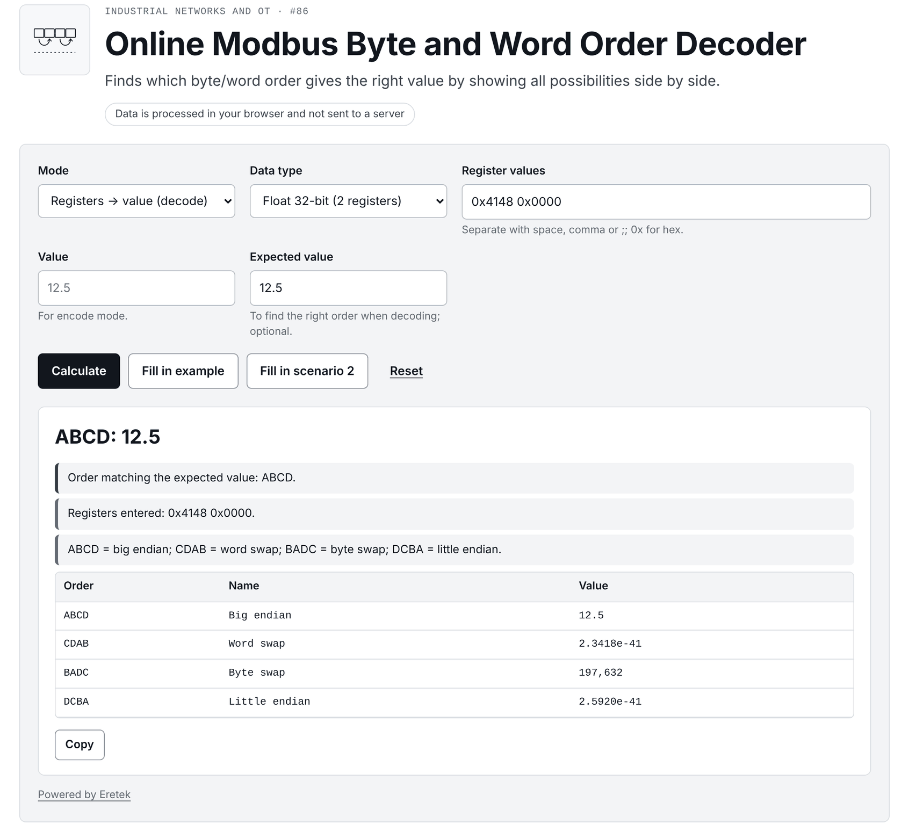

# Modbus Byte and Word Order Decoder

Decode two or four Modbus registers as 32/64-bit float or integer in ABCD, CDAB, BADC and DCBA byte orders; encode a value back to registers.

## Try it live

- [Türkçe](https://endustriyel.eretek.com/araclar/modbus-veri-dizilimi)
- [English](https://endustriyel.eretek.com/en/tools/modbus-byte-word-order)
- [Deutsch](https://endustriyel.eretek.com/de/werkzeuge/modbus-byte-word-order)



## What it does

Finds which byte/word order gives the right value by showing all possibilities side by side.

Modbus registers are 16 bits; a 32-bit float or integer spans two registers, 64-bit values four. Vendors order the parts differently (big endian ABCD, word swap CDAB, byte swap BADC, little endian DCBA). If SCADA shows '4.2e−41' instead of '12.5', the order is wrong. The tool shows all four orders at once and marks the right one if you enter the expected value.

## Where it helps

Transfer the order found to the SCADA/PLC driver's 'byte swap', 'word swap' or 'endianness' setting. Use the Modbus Register Address Converter to make sure the address is right.

## How to use it

1. In decode mode enter the registers in decimal or 0x hex separated by spaces and choose the data type.
2. Enter the true value you know in 'Expected value' (e.g. temperature on the panel).
3. In encode mode enter a value to get the registers to write in each order.

### Fields

| Field | Description |
|---|---|
| Mode |  |
| Data type |  |
| Register values | Separate with space, comma or ;; 0x for hex. |
| Value | For encode mode. |
| Expected value | To find the right order when decoding; optional. |

## Example input

Press **Fill in example** in the tool to load this input.

| Input | Value |
|---|---|
| Mode | `Registers → value (decode)` |
| Data type | `Float 32-bit (2 registers)` |
| Register values | `0x4148 0x0000` |
| Expected value | `12.5` |

**Expected result:** 0x4148 0x0000 → 12.5 in ABCD order (matches the expected value); the other orders give meaningless values (e.g. 2.3e-41 or 197,632).

## Method and assumptions

Registers are turned into a big-endian byte array (register 1 = A B, register 2 = C D …). Each order rearranges these bytes and reads them as IEEE 754 float or two's complement integer. Negative decimal register values (−32768…−1) are taken as 16-bit two's complement.

## Limits and common mistakes

- 64-bit integers, BCD, strings and scaled values (e.g. ×0.1) are not decoded; apply the scale to the result separately.

## Run it locally

The tool is plain HTML, CSS and JavaScript with no build step and no dependencies.

```bash
git clone https://github.com/eretek/modbus-byte-word-order.git
cd modbus-byte-word-order
node scripts/serve.js        # or: python3 -m http.server 8080
```

Open <http://127.0.0.1:8080/>. Add `?lang=tr` or `?lang=de` for Turkish or German; without it the page follows the browser language and falls back to English. You can also open `index.html` directly from disk.

Run the tests (Node.js 18 or later):

```bash
node test/run.js    # or: npm test
```

The tests run the tool's own fixtures and the worked examples in all three languages without a browser.

## How it works

All processing happens in your browser. The tool makes no network requests, uses no cookies or browser storage, and does not upload files you select.

No server-side component is needed. The version on the Eretek website renders the same page through a private WordPress plugin; that plugin only produces the page markup and is not part of this repository.

| Path | Purpose |
|---|---|
| `index.html` | Page shell |
| `src/app.js` | Builds the page in Turkish, English or German from `src/data.js` |
| `src/data.js` | Field definitions, examples and all texts in three languages |
| `src/core.js` | Shared runtime: validation, number formats, result rendering, CSV/ICS export |
| `src/tool.js` | The calculation or analysis for this tool |
| `docs/screenshot.png` | Screenshot used in this README |
| `src/tools.css`, `src/page.css` | Styles |
| `test/run.js`, `test/cases.json` | Headless tests |

## License and attribution

This tool is released under the [Eretek Website Attribution License](LICENSE). You may use, modify and redistribute it, including commercially. If you make it available on a website or web application, show a visible, clickable credit linking to https://eretek.com/ on every page where the tool is available, for example:

```html
<a href="https://eretek.com/">Powered by Eretek</a>
```

You may add `rel="nofollow"` to the link. Keep the copyright notice and license text in copies and redistributions.
